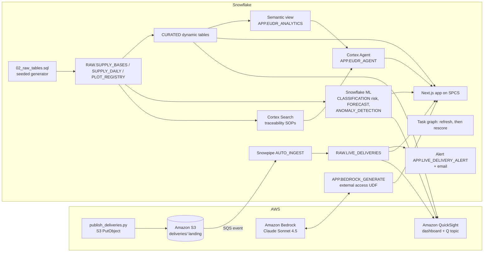

# Indonesia Palm Oil EUDR Due-Diligence Readiness

End-to-end traceability analytics for **40 supply bases in a fictional palm oil supplier network across 8 Indonesian mill-hub cities** (Pekanbaru, Medan, Jambi, Palembang, Pontianak, Palangka Raya, Samarinda, Banjarmasin) and 5 supplier types, using Snowflake, optionally with AWS: from a live mill-gate fresh fruit bunch (FFB) delivery to a 7-day canopy-loss risk score, a traceability alert email and an AI action memo for the head of sustainability. Screening results are demo signals on synthetic data, not compliance verdicts.

## Architecture

A traceability pipeline built on **Snowflake** (Dynamic Tables, Snowflake ML, Cortex Search, Cortex Agent, Cortex AI_COMPLETE, SPCS) and, in the full build, **AWS** (Amazon S3, Bedrock Claude, QuickSight + Amazon Q). Mill-gate FFB delivery events land in `RAW.LIVE_DELIVERIES`. Dynamic tables curate 90 days of supply-base-day history: FFB deliveries and intake tonnes, tonnes traced to a geolocated plot, screening flags, confirmed canopy-loss cases, lots excluded from EU-bound stock, supplier geolocation declarations and plot registry coverage. Snowflake ML scores 7-day canopy-loss risk per supply base, forecasts network-wide FFB deliveries and flags geolocation mismatch anomalies. A Cortex Agent answers questions with SOP citations, and an LLM drafts the action memo.

Interactive diagrams (hover for object names): [Snowflake only](docs/architecture-snowflake.html) | [AWS + Snowflake](docs/architecture-aws.html). The app shows both on its Architecture & Data tab, the current build first. Regenerate them with `python3 docs/build_architecture.py`.



The Snowflake-only build drops the AWS subgraph: `APP.SIMULATE_DELIVERIES` writes to `RAW.LIVE_DELIVERIES`, and the app calls Cortex `AI_COMPLETE` instead of the Bedrock UDF.

## Snowflake Capabilities

| Capability | Implementation |
|-----------|---------------|
| Dynamic Tables | `CURATED.KPI_SUMMARY`, `PERFORMANCE_SUMMARY`, `SIGNAL_SUMMARY`, `TREND_ANALYSIS` from the RAW tables |
| Snowflake ML | CLASSIFICATION 7-day canopy-loss risk (`ML.CANOPY_RISK_SCORES`), 14-day FFB delivery FORECAST, geolocation mismatch ANOMALY_DETECTION |
| Cortex Search | 11 synthetic traceability follow-up SOPs (one per supplier type and risk signal) in `SEARCH.EUDR_SOP_SEARCH` |
| Semantic View | `APP.EUDR_ANALYTICS` over supply bases, risk signals, daily totals and risk |
| Cortex Agent | `APP.EUDR_AGENT`: Cortex Analyst over the semantic view plus Cortex Search for SOP citations |
| Cortex AI | `AI_COMPLETE('claude-sonnet-4-5')` for grounded answers, and for the action memo in the Snowflake-only build |
| Alerts + Tasks | `APP.LIVE_DELIVERY_ALERT` logs FLAG events and sends email; task graph `TASK_REFRESH_CURATED`, then `TASK_RESCORE_RISK` |
| Snowpark Container Services | Next.js app `APP.ID_EUDR_APP` with 6 tabs: Executive Cockpit, Predictive, Plot Registry, Live Deliveries, Ask AI, Architecture & Data |
| Snowpipe | `RAW.LIVE_DELIVERIES_PIPE` AUTO_INGEST from S3 (AWS build only) |

## AWS Services

Used only in the AWS + Snowflake build.

| Service | Role in Demo |
|---------|-------------|
| Amazon S3 | Landing bucket (`deliveries/`): `aws/publish_deliveries.py` uploads mill-gate FFB delivery batches as newline-delimited JSON. An event notification goes to the Snowpipe SQS queue |
| Amazon Bedrock | Claude Sonnet 4.5 writes the action memo, called from Snowflake through an external-access UDF |
| Amazon QuickSight | DIRECT_QUERY executive dashboard over Snowflake (daily FFB deliveries and screening flags, confirmed canopy-loss cases by supply base, canopy-loss risk) |
| Amazon Q | Natural-language questions over the QuickSight topic `id-eudr-topic` |
| AWS IAM | Least-privilege role for Snowflake S3 reads and a Bedrock-only invoke user |

## Personas

These personas are fictional.

| Persona | Role | Key Questions |
|---------|------|---------------|
| **Dewi Lestari** | Head of Sustainability | "How much of our FFB intake is traced to a geolocated plot, by supplier type?" "Which risk signals lead to confirmed canopy-loss cases?" |
| **Budi Santoso** | Traceability Analyst | "Which supply bases are high risk this week, and which SOP applies?" |

## Data

All data is synthetic and seeded, so every rebuild reproduces it. The supplier network, supply bases and names are fictional; the cities are real places used only as labels, and nothing here describes a real site.

| Table | Rows | Description |
|-------|------|-------------|
| RAW.SUPPLY_BASES | 40 | Supply bases: every combination of 8 mill-hub cities and 5 supplier types (own estate, plasma smallholders, independent smallholders, FFB dealers, third-party mills), with risk tier, years in the traceability programme and size |
| RAW.SUPPLY_DAILY | 3,600 | Daily supply-base observations over 90 days: FFB deliveries, intake and traced tonnes, screening flags, confirmed canopy-loss cases, lots excluded, risk signal, supplier declarations due and received, geolocation mismatch and unmapped-intake shares. Includes two area-wide fire hotspot cluster days (Pekanbaru and Palangka Raya) |
| RAW.PLOT_REGISTRY | 40 | Registered plots, plots with geolocation on file and geolocation checks pending per supply base |
| SEARCH.EUDR_SOP_DOCS | 11 | Synthetic traceability follow-up SOPs indexed for Cortex Search (not legal advice) |
| RAW.LIVE_DELIVERIES | Grows during the demo | Live mill-gate FFB delivery events from S3 (AWS build) or `APP.SIMULATE_DELIVERIES` (Snowflake-only build) |
| ML.CANOPY_RISK_SCORES | 40 | 7-day canopy-loss probability and risk band per supply base |

## Build Instructions

### Prerequisites
- Snowflake account with ACCOUNTADMIN access, and Cortex AI enabled (AI_COMPLETE, Search, Agent).
- An X-Small warehouse with auto-suspend at or below 120 s, and an existing SPCS compute pool.
- Python 3.11+, `snowflake-connector-python`, Node.js 22+, Docker and the `snow` CLI.
- App image: run `snow spcs image-registry login`, then build and push `id-eudr-app:v1` to the database's `APP.IMAGES` repository (see the header of `snowflake/07_deploy_app.sql`).
- AWS build only: `boto3`, AWS credentials for the target account (us-west-2) with Bedrock access, and QuickSight Enterprise.

### SPCS App
```
<DATABASE>.APP.ID_EUDR_APP
```

### Tests
```bash
python -m pytest aws snowflake quicksight
```

For a local run, put `SNOWFLAKE_ACCOUNT`, `SNOWFLAKE_USER`, `SNOWFLAKE_DATABASE`, `SNOWFLAKE_WAREHOUSE`, `SNOWFLAKE_AUTHENTICATOR=PROGRAMMATIC_ACCESS_TOKEN`, `SNOWFLAKE_TOKEN` and `DEMO_PLATFORM` in the environment, then run `npm --prefix app run build && npm --prefix app start`.

## Build Modes

Both modes share the same core. They differ in three places, and the app's `DEMO_PLATFORM` setting (in its SPCS spec) switches the memo provider and the Live Deliveries tab.

| Layer | Snowflake Only | Full AWS + Snowflake |
|---|---|---|
| Live deliveries | `CALL APP.SIMULATE_DELIVERIES(n)` inserts simulated mill-gate FFB delivery events into `RAW.LIVE_DELIVERIES`. This simulates a mill weighbridge feed; it is not Snowpipe Streaming | `aws/publish_deliveries.py` uploads FFB delivery batches to S3, then SQS and Snowpipe AUTO_INGEST |
| Action memo | Cortex `AI_COMPLETE('claude-sonnet-4-5')` | Amazon Bedrock Claude Sonnet 4.5 through `APP.BEDROCK_GENERATE` |
| BI and natural-language questions | The SPCS app is the dashboard; questions go to the Cortex Agent | Also a QuickSight dashboard and an Amazon Q topic |
| App setting | `DEMO_PLATFORM: snowflake` | `DEMO_PLATFORM: aws` |

### Snowflake Only

```bash
# 1. Core data and dynamic tables (guarded: new isolated database only)
python snowflake/run_core.py --database INDONESIA_PALM_EUDR_SNOWFLAKE --warehouse <XS_WAREHOUSE> --connection <CONNECTION> --apply
# 2. Native FFB delivery feed, ML, search, semantic view, agent, alert and task graph
python snowflake/run_intelligence.py --database INDONESIA_PALM_EUDR_SNOWFLAKE --platform snowflake --warehouse <XS_WAREHOUSE> --connection <CONNECTION> --alert-email you@example.com
# 3. App on SPCS with DEMO_PLATFORM=snowflake (push the image first)
python snowflake/run_intelligence.py --database INDONESIA_PALM_EUDR_SNOWFLAKE --platform snowflake --warehouse <XS_WAREHOUSE> --connection <CONNECTION> --alert-email you@example.com --files 07_deploy_app.sql --compute-pool <COMPUTE_POOL>
```

During the demo:
- Run `CALL APP.SIMULATE_DELIVERIES(20)` to add live delivery events. For a continuous feed, run `ALTER TASK APP.TASK_SIMULATE_DELIVERIES RESUME`, and `SUSPEND` it afterwards.
- Run `EXECUTE ALERT APP.LIVE_DELIVERY_ALERT` to raise the traceability alert email.
- Run `EXECUTE TASK APP.TASK_REFRESH_CURATED` to refresh the curated tables and rescore risk.

Afterwards, drop the database or run `ALTER SERVICE APP.ID_EUDR_APP SUSPEND`.

### Full AWS + Snowflake

```bash
# 1. Core data and dynamic tables (guarded: new isolated database only)
python snowflake/run_core.py --database INDONESIA_PALM_EUDR_AWS --warehouse <XS_WAREHOUSE> --connection <CONNECTION> --apply
# 2. AWS ingestion and Bedrock (dry run first, then --apply)
python aws/setup_aws.py --database INDONESIA_PALM_EUDR_AWS --account <AWS_ACCOUNT_ID> --connection <CONNECTION> --apply
# 3. ML, search, semantic view, agent, alert and task graph
python snowflake/run_intelligence.py --database INDONESIA_PALM_EUDR_AWS --platform aws --warehouse <XS_WAREHOUSE> --connection <CONNECTION> --alert-email you@example.com
# 4. App on SPCS with DEMO_PLATFORM=aws (push the image first)
python snowflake/run_intelligence.py --database INDONESIA_PALM_EUDR_AWS --platform aws --warehouse <XS_WAREHOUSE> --connection <CONNECTION> --alert-email you@example.com --files 07_deploy_app.sql --compute-pool <COMPUTE_POOL>
# 5. QuickSight dashboard and Q topic (needs an existing Snowflake data source)
python quicksight/build_dashboards.py --database INDONESIA_PALM_EUDR_AWS --account <AWS_ACCOUNT_ID> --principal-arn <QUICKSIGHT_USER_ARN> --data-source-arn <DATA_SOURCE_ARN> --prefix id-eudr --apply --update --with-topic
```

QuickSight objects must be shared with the QuickSight user who signs in (`--principal-arn`); otherwise the console shows nothing.

During the demo:
- Run `python aws/publish_deliveries.py --account <AWS_ACCOUNT_ID> --count 20` to upload a batch of live delivery events. Snowpipe loads it within about a minute.
- Run `EXECUTE ALERT APP.LIVE_DELIVERY_ALERT` to raise the traceability alert email.
- Run `EXECUTE TASK APP.TASK_REFRESH_CURATED` to refresh the curated tables and rescore risk.

Afterwards, `python aws/teardown_aws.py --database INDONESIA_PALM_EUDR_AWS --account <AWS_ACCOUNT_ID> --connection <CONNECTION> --apply` removes the AWS resources and the account-level Bedrock external-access and S3 storage integrations. It leaves the email integration `ID_EUDR_EMAIL_INT`, which the Snowflake-only build also uses.

## Business Impact

Regulatory context and Snowflake customer outcomes:
- **The EU Deforestation Regulation (EUDR) requires that, from 30 December 2026, products placed on, sold within, or exported from the EU are free from deforestation**, and its scope includes palm oil -- [European Commission Green Forum, Implementing the EUDR](https://green-forum.ec.europa.eu/nature-and-biodiversity/deforestation-regulation-implementation_en)
- **Non-EU producers and companies may be asked to provide information, such as the locations where products were grown**, to help EU-based companies meet their requirements -- [European Commission Green Forum, Implementing the EUDR](https://green-forum.ec.europa.eu/nature-and-biodiversity/deforestation-regulation-implementation_en)
- **Honeywell** (Snowflake customer) transitioned from managing 33 separate enterprise data warehouses to a unified Snowflake AI Data Cloud, which helps it manage a supply chain with thousands of suppliers -- [Snowflake customer story: Honeywell](https://www.snowflake.com/en/customers/all-customers/video/honeywell/)

## Key Demo Numbers

These figures are synthetic and come from the seeded demo data. Forecast and anomaly figures can shift slightly with the build day.

- **40 supply bases** (8 cities x 5 supplier types), 3,600 supply-base-days over 90 days: **193,855 FFB deliveries** and 1,117.4 kt of FFB intake, with **76.9% traced to a geolocated plot**. By supplier type, own estates trace highest (94.0%) and FFB dealers lowest (56.6%)
- **598 screening flags** and **116 confirmed canopy-loss cases**, so flag precision is 19.4%; **61 lots** excluded from EU-bound stock. The supply base with the most confirmed cases is SB-0034 Jambi Third-party mills (11)
- **Canopy loss alert near plot** produces the most confirmed cases (42 of 212 flags); the 10 fire hotspot cluster flags are never confirmed
- **Canopy-loss risk model** out-of-time holdout: precision 0.51, recall 0.35 at a 0.5 threshold, against a 0.165 base rate. Six supply bases are high risk; the top one is SB-0001 Medan Own estate, at 93.4%
- **14-day FFB delivery forecast** of about 2,130-2,140 deliveries per day, with prediction intervals; **35 of 640** supply-base-days flagged as geolocation mismatch anomalies
- **Supplier declaration rate 80.9%**, plot geolocation coverage 69.2% of 21,665 registered plots, with 2,324 geolocation checks pending
- **11 SOPs** indexed for Cortex Search and cited by ID in agent answers

## License

Apache 2.0 — See [LICENSE](LICENSE) for details.

This is a personal demo project and is not an official Snowflake offering. It comes with no support or warranty. It is not legal or compliance advice. Regulatory statements are taken from the cited European Commission page, and customer outcomes from the cited Snowflake customer story; they are not guarantees of results.
